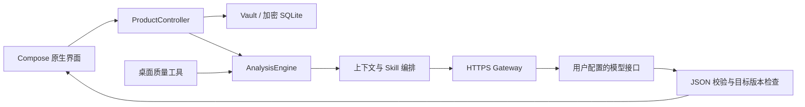

# 个性化对话辅助 Android 应用

基于 **Kotlin / Jetpack Compose** 的原生 Android 应用，通过经用户核对的聊天历史、联系人档案和表达习惯，组织多视角分析与个性化回复候选。当前同步版本为 **0.3.7-preview / versionCode 9**，支持 Android 11+。

项目重点是将大模型能力落到可操作的产品流程：**历史导入 → 来源校对 → 档案隔离 → 双 Skill 分析 → 结构化候选 → 人工编辑与复制**。原生应用、独立核心模块和桌面质量工具复用同一分析引擎。

## 产品能力

| 模块 | 已实现能力 | 解决的问题 |
|---|---|---|
| 本机账户 | 注册、登录、改密、退出锁定与逻辑账户隔离 | 共享设备上资料混用与会话越界 |
| 聊天工作区 | 文本 / 文件 / 截图 OCR 导入、草稿校对、顺序整理与来源回查 | 历史不完整、OCR 错字及重复导入 |
| 联系人档案 | 稳定 ID、备注、边界、长期事实与冲突记录 | 同名联系人误合并、档案缺少依据 |
| 分析与候选 | 双 Skill 编排、上下文组织、候选分段编辑、草稿保存和逐条复制 | 通用回复缺少个性、结果难以采用 |
| 设置与费用 | HTTPS 接口配置、组件开关、预算预留、usage 计费与未知费用记录 | 异常调用导致费用失控或状态不透明 |
| 原生界面 | “军师 / 聊天 / 档案 / 我的”四页导航、浅深主题、统一视觉样式与表单状态保留 | 功能入口分散及长流程操作负担 |

## 模块化架构



| 工程模块 | 职责与入口 |
|---|---|
| [`product-app`](product-app) | Compose 页面、`ProductController`、`Vault`、前台读屏和 Android 生命周期 |
| [`product-core`](product-core) | 独立 Kotlin 核心：历史模型、范围校验、上下文、编排、HTTP 契约、费用及加密格式 |
| [`qa-runner`](qa-runner) | 复用产品引擎的桌面对照与批次工具；编译不触发真实推理 |
| [`qa`](qa) / [`scripts`](scripts) | 合成输入、离线审阅、严格评分、构建与报告工具 |
| [`app`](app) / [`probe-core`](probe-core) | 保留独立读屏探针及早期证据规则，便于追溯产品方案变化 |

界面状态经控制器协调，文件与模型操作使用独立执行器；异步结果回到主线程前检查会话范围和版本。核心模块不依赖 Android，便于 JVM 单元验证与桌面复用。

## 关键技术设计

### 上下文工程与双 Skill 工作流

通过 **Context Engineering（上下文工程）** 将经核对的历史、来源证据、联系人事实、历史缺口及已确认的表达样本组织为模型输入。默认分别执行两套已锁定的 Skill，再由生成模型融合；Jev 为可选组件，默认关闭。

启用组件失败时明确失败，不静默省略。输出进行严格 JSON 与证据引用校验，拒绝截断、字段不合法和无法定位的结果；只有实际发送且经用户确认的内容参与表达习惯学习。

相关实现：[`Analysis.kt`](product-core/src/main/kotlin/cn/xindong/core/Analysis.kt)、[`StyleAndContext.kt`](product-core/src/main/kotlin/cn/xindong/core/StyleAndContext.kt)、[`SkillOutput.kt`](product-core/src/main/kotlin/cn/xindong/core/SkillOutput.kt)。

### 数据隔离、加密与一致性

- **Scope 隔离：** Account / Streamer / Contact 使用稳定随机 ID，昵称仅用于显示。
- **Authenticated Encryption：** 业务记录采用 AES-256-GCM，Android Keystore 保存设备密钥；AAD 绑定记录类型、范围和 ID。
- **媒体保护：** 分块认证加密结合长度、块数与 SHA256 校验，拒绝截断、重排和跨档案解密。
- **本机账户：** 随机盐与 PBKDF2 口令校验，限制连续失败尝试；属于应用内解锁及逻辑隔离。
- **幂等与失效保护：** 导入批次和最新消息观察记录拒绝重放；`ReplyTarget` 绑定尾部消息与版本，切换档案、修改历史或锁定账户时取消旧任务并丢弃过期候选。

### OCR、HTTP 契约与费用治理

AccessibilityService 读取经授权的当前可见窗口，使用本地中文 OCR 生成待核对材料；包名、窗口、锁屏、导航和请求状态共同限制读取范围。OCR 结果必须经过用户核对，候选复制后由用户自行发送。

网关处理 HTTPS、取消、响应格式及 SSE 完成标记。费用模块在调用前预留预算，调用后按 usage 结算；中断或费用未知时保留未确认记录，避免把失败调用直接记为零成本。

## 构建与工程验证

需要 **JDK 17、Android SDK 36、Build Tools 35.0.0**；项目使用 Gradle Wrapper、依赖锁及固定的第三方 Skill 清单。

以下为 **Windows PowerShell**，在项目根目录执行：

```powershell
# 自动选择本机已有 JDK / SDK；也可传入 -JavaHome 与 -SdkRoot
.\scripts\Build-Product.ps1
python -m unittest discover -s scripts/tests -v
```

构建脚本执行核心测试、Android 本地单元测试、QA 工具编译、lint 与 Debug APK 构建。`local.properties`、构建缓存和 `deliverables/` 不提交；实际模型服务与密钥由使用者在本机配置。

本次同步补齐了锁定 Skill 的运行时参考文件，并保持其原始 SHA256 与许可证。当前复验范围及历史设备结果见 [`VALIDATION.md`](VALIDATION.md)。

## 完成度与后续范围

当前为工程预览版，已经实现本机账户、历史核对、档案、候选编辑和配置费用流程，0.3.7 更新了原生界面与交互布局。原工程模拟器报告、本次源码副本构建复验和旧版有限真机结果分别记录，不混作新版真机验收。

前台 OCR 仍可能出现错字，完整微信历史、无人核对的自动消息识别、跨设备同步、iOS、自动语音转写与换机恢复尚未实现。质量批次保持原已停止状态，人工评分及正式对照验收未完成；本次同步不调用付费接口，也不恢复已停止批次。

## 文档与第三方许可

- [工程架构](docs/ARCHITECTURE.md) · [阶段记录](docs/STATUS.md)
- [0.3.7 使用指南](docs/USER_GUIDE_0.3.7.md) · [界面设计系统](docs/UI_DESIGN_SYSTEM.md) · [本次界面调整](docs/CHANGE_REQUEST_20261015_UI.md)
- [0.3.7 原工程界面报告](docs/UI_TEST_REPORT_20261015.md) · [0.3.7 原工程交付记录](docs/DELIVERY_0.3.7.md)
- [工程测试记录](docs/TEST_REPORT.md) · [已知问题](docs/KNOWN_ISSUES.md)
- [第三方来源](docs/THIRD_PARTY.md) · [Skill 文件锁](research/skill-files.json) · [许可证](research/licenses)

工程文档中较早的版本与交付链接作为历史记录保留。GitHub 发布源码、规格、依赖锁、合成输入和许可证，不附带真实聊天、私人截图、API Key 或本机交付安装包。第三方 Skill 按原许可保留，不计为本项目原创。
